電子回路の計算と、楽器・光学・天文のシミュレーションができるツール集です。

<https://nanase.cc/tools/>

## 動かし方

[mise](https://mise.jdx.dev/) で Node と bun を入れてから、次を実行します。

```sh
mise install
bun install
bun run dev
```

<http://localhost:4321/tools/> で開きます。ほかのコマンドと公開の仕組みは [DEVELOPMENT.md](DEVELOPMENT.md) にあります。

## ライセンス

MIT です。

ただし、次のデータには元のライセンスが付きます。出典とライセンスはリンク先にあります。

- 楽器のページの曲: [SCORES.md](SCORES.md)
- ハロ（暈）のページの写真（`public/photos/halo/`）: [src/tools/halo/photos.ts](src/tools/halo/photos.ts)
- 日食のページのデータ: [src/tools/solar-eclipse/SOURCES.md](src/tools/solar-eclipse/SOURCES.md)
- 月のページのデータ: [src/tools/moon/SOURCES.md](src/tools/moon/SOURCES.md)
